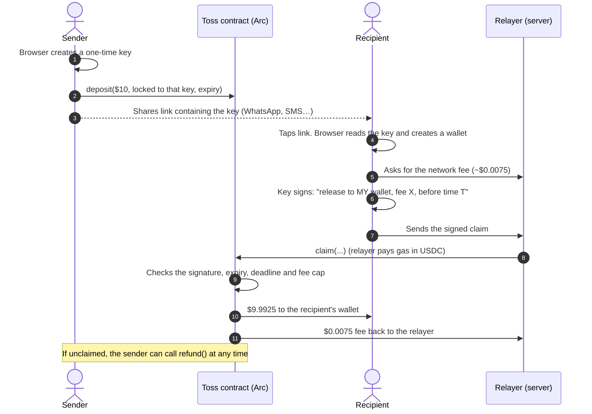

<p align="center"></p>

# Toss

**Send dollars to anyone with a link.** Pick an amount, share the link on WhatsApp, SMS or email, and the person who
taps it gets the money. They don't need an app, a seed phrase or a crypto "gas" token. If nobody claims it, the
sender gets it back.

Toss is built on [Arc](https://arc.io), Circle's blockchain for USDC (a digital US dollar), and runs on **Arc
mainnet** with real money.

| | |
|---|---|
| 🌐 **Live app** | https://toss-beryl.vercel.app |
| 🎬 **Demo video** | [Watch on Google Drive](https://drive.google.com/drive/folders/1j6680WEELKj7B0DNSUjBt9Gx7Ape4bt1) |
| 📜 **Smart contract** | [`0x83b2…38f6` on Arc mainnet](https://explorer.arc.io/address/0x83b2b7b0A4EeB7d47C02e21e49ab30219Df638f6) |

---

## Contents

1. [The problem](#the-problem)
2. [What Toss does](#what-toss-does)
3. [How it works for people](#how-it-works-for-people)
4. [Why this only works this well on Arc](#why-this-only-works-this-well-on-arc)
5. [How it works under the hood](#how-it-works-under-the-hood)
6. [Security](#security)
7. [Tech stack](#tech-stack)
8. [Repository layout](#repository-layout)
9. [Run it yourself](#run-it-yourself)
10. [Deployment details](#deployment-details)
11. [Limitations and what's next](#limitations-and-whats-next)

---

## The problem

Sending stablecoins to someone new is still hard:

- **They need a wallet first.** Most people don't have one, and setting one up means installing an app and writing
  down a 12-word seed phrase.
- **They need a gas token.** On most blockchains, a new wallet can't move its money until someone gives it the
  chain's own token (ETH, SOL…) to pay network fees. So "here's $10 in USDC" turns into "first, go buy some ETH."
- **You need their address.** A long `0x…` string, copied without a single mistake.

Link-based payment apps exist, but on other chains someone has to **subsidise gas** for every new user, which costs
money and doesn't scale.

## What Toss does

Toss turns money into a link, the way you'd share a photo.

- **The sender** picks an amount and gets a link.
- **The recipient** taps it and the money lands in a wallet created on the spot, right in their browser.
- **Nobody** needs an app, a seed phrase or a gas token.
- **Unclaimed money** goes back to the sender. They can also take it back any time before it's claimed.

Once claimed, the recipient holds real USDC. They can send it to any wallet, or send it on as a new Toss link.

## How it works for people

### Sending

1. Open the app and type an amount, e.g. **$10**.
2. Choose when it expires: **1 hour, 24 hours, 7 days** or a custom number of days.
3. Tap **Create link**. Your $10 is locked safely in the Toss contract.
4. Share the link however you like: WhatsApp, Messages, email, or copy it.

You can pay from a **Toss wallet** in your browser (the default on phones), a **browser wallet** like MetaMask, or a
**wallet app** on your phone via WalletConnect.

### Receiving

1. Tap the link. You see **"You received $10.00"**.
2. Tap **Claim to new wallet**, or **Claim to existing wallet** if you already have one.
3. About a second later: **Claimed ✓**. The money is yours.

A network fee of under one cent comes out of the amount. That's all the recipient ever pays.

### After claiming

- **Send or spend:** move the USDC to any wallet address.
- **Send as a Toss link:** pass money on to someone else (links start at $1).
- **Back up:** the Toss wallet lives in your browser, so the app asks you to save its backup key.

### Taking it back

Open **History**, tap a pending link, and tap **Take it back**. The money returns to your wallet.

## Why this only works this well on Arc

On Arc, **network fees are paid in USDC**, the same token being sent. That changes the economics:

| | Most blockchains | Arc |
|---|---|---|
| A brand-new wallet can move its money | ❌ Only after someone sends it ETH/SOL for fees | ✅ Yes. It already holds USDC, which pays fees |
| Who pays the gas for a claim | A sponsor who keeps topping up a gas balance | The claim itself, from a tiny USDC fee taken out of the amount |
| Tokens the recipient needs | Two (USDC plus the gas token) | One (USDC) |
| Time until the money arrives | Seconds to minutes | Under a second (instant finality) |

Toss uses a **relayer**, a small server that submits the claim and pays its gas. The contract reimburses the
relayer a capped USDC fee out of the claimed amount. Gas and reimbursement are the **same token**, so the system pays
for itself and needs no subsidy.

## How it works under the hood

### The key idea: a one-time key in the link

When you create a link, your browser generates a fresh, single-use cryptographic key. Your USDC is locked in the
contract so that **only whoever holds that key** can release it. The key travels inside the link, after the `#`:

```
https://toss-beryl.vercel.app/c#k=0x3f9a…
                               └─ the part after "#" is never sent to any server
```

Browsers never send the part after `#` to a server, so the key goes from the sender's browser to the recipient's
browser without passing through Toss's servers.

### The full flow



### The three parts

| Part | Where it runs | What it does |
|---|---|---|
| **Toss contract** ([`Toss.sol`](smartcontract/src/Toss.sol)) | Arc mainnet | Holds deposits and enforces every rule. No owner and no admin keys, so nobody can freeze or take funds. |
| **Web app** ([`frontend/`](frontend/)) | The user's browser | Creates links, signs claims, holds the browser wallet. |
| **Relayer** ([`api/quote`](frontend/src/app/api/quote/route.ts), [`api/claim`](frontend/src/app/api/claim/route.ts)) | Vercel server | Quotes the fee, tests each claim, submits it and pays its gas. It never holds user funds or link keys. |

### The contract in three functions

| Function | Who calls it | What happens |
|---|---|---|
| `deposit(claimKey, amount, expiry)` | Sender | Locks USDC to the one-time key's address until expiry (1 hour to 30 days). Minimum $1. |
| `claim(claimKey, recipient, fee, deadline, signature)` | Relayer | If the one-time key signed exactly this recipient, fee and deadline, it sends `amount − fee` to the recipient and `fee` to the relayer. The fee is capped at $0.05. |
| `refund(claimKey)` | Sender only | Returns an unclaimed deposit, before or after expiry. |

The signature uses the EIP-712 standard and includes Arc's chain ID and the contract's address, so a claim can't be
replayed on another network or another contract. Each key can be used **exactly once**.

### Following a dollar

```
Sender's wallet ──$10──▶ Toss contract ──$9.9925──▶ Recipient's wallet
                              │
                              └──$0.0075──▶ Relayer (spent ~$0.005 on gas)

Unclaimed?  Toss contract ──$10──▶ back to the sender
```

## Security

| Risk | How Toss handles it |
|---|---|
| Someone copies a claim transaction and redirects the money | The signature names one recipient. Changing it makes the signature invalid. |
| The relayer takes a bigger fee | The fee is part of what the recipient signs, and the contract caps it at $0.05. |
| The same claim is used twice, or on another chain | The deposit is deleted when claimed, each key works once, and the chain ID and contract address are signed. |
| An email scanner or chat preview "opens" the link | The claim page never claims on its own. A person has to tap. |
| The key leaks through server logs or referrer headers | The key lives only after `#`, which never reaches a server. The page strips it from the address bar and sends no referrer. |
| The relayer wastes gas on bad claims | Every claim is simulated first, so failing claims are rejected before any gas is spent. |
| Nobody claims the link | It expires, and the sender can refund at any time. |
| **Someone else gets the link** | **Like cash in an envelope: whoever holds it can claim it.** The app says so on the share screen. |
| **The recipient clears their browser** | The browser wallet would be lost, so the app prompts a backup and offers "send everything to my other wallet". |

The contract has **24 automated tests**, including fuzz tests, covering all of the above. See
[`Toss.t.sol`](smartcontract/test/Toss.t.sol).

## Tech stack

| Layer | Technology |
|---|---|
| Blockchain | Arc mainnet (chain 5042), native USDC |
| Smart contract | Solidity 0.8.28, OpenZeppelin 5.4 (EIP-712, ECDSA, SafeERC20), Foundry |
| Web app | Next.js 16 (App Router), TypeScript, Tailwind CSS 4, Framer Motion, lucide icons |
| Wallets | viem, wagmi, WalletConnect (Reown) |
| Relayer | Next.js API routes on Vercel |

## Repository layout

```
Toss/
├── smartcontract/                 Foundry project
│   ├── src/Toss.sol               The escrow contract
│   ├── test/Toss.t.sol            24 tests (incl. fuzzing)
│   ├── script/Deploy.s.sol        Arc mainnet deploy
│   └── script/DeployLocal.s.sol   Local deploy with a mock USDC
└── frontend/                      Next.js app (also hosts the relayer)
    ├── src/app/(sender)/          Create-link screen and History
    ├── src/app/(recipient)/       Claim screen and Wallet
    ├── src/app/api/               Relayer: /api/quote and /api/claim
    ├── src/components/ui/         Design system (Button, Sheet, Toast…)
    ├── src/components/toss/       Product components (CreateForm, ClaimCard…)
    └── src/lib/                   Chain config, contract calls, wallet helpers
```

## Run it yourself

### Prerequisites

- [Foundry](https://book.getfoundry.sh/getting-started/installation) for the contract
- Node.js 20+ and [pnpm](https://pnpm.io) for the app

### 1. Smart contract

```bash
git clone --recurse-submodules https://github.com/Abidoyesimze/Toss.git
cd Toss/smartcontract
forge test
```

### 2. Web app

```bash
cd ../frontend
pnpm install
cp .env.example .env.local
pnpm dev                      # http://localhost:3000
```

Fill in `.env.local`:

| Variable | What it is |
|---|---|
| `NEXT_PUBLIC_TOSS_ADDRESS` | The Toss contract (`0x83b2b7b0A4EeB7d47C02e21e49ab30219Df638f6` on mainnet) |
| `NEXT_PUBLIC_USDC_ADDRESS` | Arc USDC (`0x3600000000000000000000000000000000000000`) |
| `NEXT_PUBLIC_RPC_URL` | `https://rpc.mainnet.arc.io` |
| `RELAYER_PK` | Private key of the relayer wallet. **Server only, never commit it.** Fund it with ~$0.50 of USDC on Arc. |
| `NEXT_PUBLIC_WC_PROJECT_ID` | Optional. A free [Reown](https://cloud.reown.com) project ID to enable WalletConnect. |

### 3. Fully local (no real money)

```bash
anvil                                             # local test chain
cd smartcontract
forge script script/DeployLocal.s.sol --rpc-url http://127.0.0.1:8545 --broadcast \
  --private-key 0xac0974bec39a17e36ba4a6b4d238ff944bacb478cbed5efcae784d7bf4f2ff80   # anvil's public test key
```

Then set `NEXT_PUBLIC_CHAIN=local`, `NEXT_PUBLIC_RPC_URL=http://127.0.0.1:8545`, and the `Toss` and `MockUSDC`
addresses printed by the script in `frontend/.env.local`.

### Deploying the contract

```bash
cast wallet import toss-deployer --interactive    # encrypted keystore, never a raw key
forge script script/Deploy.s.sol --rpc-url arc --account toss-deployer --broadcast
```

## Deployment details

| | |
|---|---|
| Network | Arc mainnet, chain ID `5042` |
| Toss contract | [`0x83b2b7b0A4EeB7d47C02e21e49ab30219Df638f6`](https://explorer.arc.io/address/0x83b2b7b0A4EeB7d47C02e21e49ab30219Df638f6) |
| Deploy transaction | [`0xd6db85…ff03`](https://explorer.arc.io/tx/0xd6db8539e67e99c7b26ef5b1f70813c908ef84850e979a1547d80a00aedbff03) |
| USDC (ERC-20 interface, 6 decimals) | `0x3600000000000000000000000000000000000000` |
| Minimum link | $1.00 |
| Maximum relayer fee | $0.05 (typical: ~$0.0075) |
| Link lifetime | 1 hour to 30 days |
| Web app | https://toss-beryl.vercel.app (Vercel) |

> **Note for developers:** Arc reports the same USDC balance with 18 decimals as the native gas token and with 6
> decimals through the ERC-20 interface. Toss does all its accounting in the 6-decimal ERC-20 interface.

## Limitations and what's next

**Current limitations (by design for the MVP):**

- The browser wallet lives in one browser. Claiming in one browser and opening the app in another won't show the
  wallet unless it's restored from its backup key.
- Anyone with a link can claim it. Treat links like cash.
- "History" shows links created on the current device.
- The relayer's rate limits are kept in memory per server instance. The contract still prevents double claims.

**What's next:**

- 🔐 **Password-protected links**: the key in the link is encrypted with a password shared separately.
- 🔑 **Passkey wallets**: recover your wallet with Face ID or a fingerprint instead of a backup key.
- 💸 **Cash-out**: move USDC to bank or mobile money, or bridge to other chains with Circle's CCTP.
- 👥 **Group links**: one link that several people can each claim a share of.
